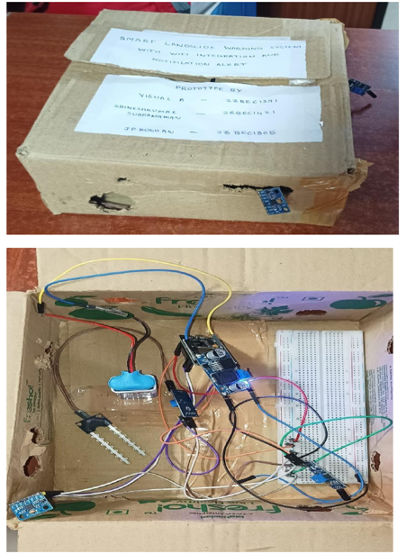
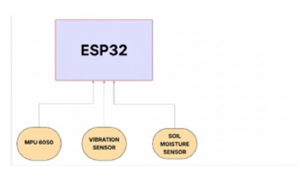
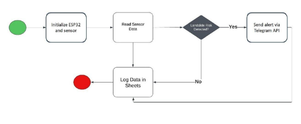
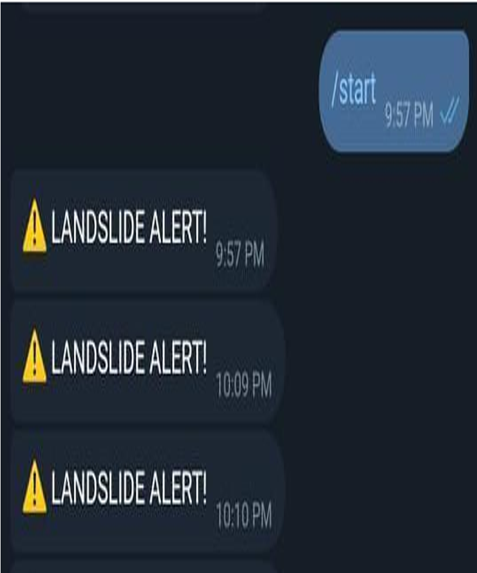
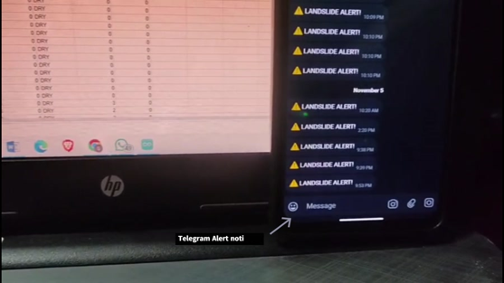
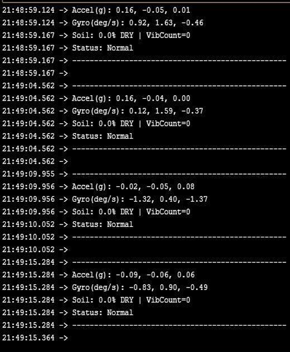

# Smart-Landslide-Warning-System

## 1. Overview

The Smart Landslide Warning System is an IoT-based prototype designed to monitor changes in ground conditions that may indicate a possible landslide risk. It uses an ESP32 connected to a soil moisture sensor, an MPU6050 accelerometer and gyroscope, and an SW-420 vibration sensor.

The ESP32 reads the sensor values, checks them against predefined limits, and combines the results to decide whether a warning condition is present. Through Wi-Fi, the system sends a Telegram alert when the risk rule is met and uploads sensor readings to Google Sheets for remote viewing and later analysis.

The prototype is intended to demonstrate continuous sensing, threshold-based risk indication and remote notification.

*Figure 1. Working prototype*

## 2. Key Features

- Continuous monitoring of soil moisture, vibration and ground movement
- ESP32-based sensor acquisition and threshold checking
- Combined three-condition risk decision
- Telegram warning notifications over Wi-Fi
- Live sensor-data logging to Google Sheets
- Serial Monitor output for local debugging
- Low-cost prototype using commonly available sensors
- Remote access to recorded readings

## 3. System Architecture

The system follows a sensor-to-controller-to-cloud architecture. The three sensors provide measurements to the ESP32. The controller processes the readings and evaluates the risk conditions. Wi-Fi is then used to send an alert through the Telegram Bot API and to upload the sensor values to a Google Sheets web endpoint.

*Figure 2. Hardware block diagram*

| Stage | Main function |
|---|---|
| Sensing | MPU6050 measures acceleration and angular velocity; SW-420 detects vibration events; soil probe measures moisture. |
| Controller | ESP32 reads the sensors, applies calibration and thresholds, and determines the risk state. |
| Connectivity | ESP32 connects to a Wi-Fi network and sends HTTP requests to the online services. |
| Notification | Telegram Bot API delivers a landslide alert when at least two of the three risk conditions are active. |
| Data logging | Google Sheets stores timestamped sensor readings and the risk flag for remote monitoring. |

## 4. Hardware and Software Components

### 4.1 Hardware Components

| Component | Role in this project |
|---|---|
| ESP32 development board | Acts as the main controller, reads the sensors, evaluates risk conditions and manages Wi-Fi communication. |
| MPU6050 accelerometer and gyroscope | Measures acceleration on three axes and angular velocity on three axes; the current risk rule uses the X- and Y-axis acceleration values. |
| SW-420 vibration sensor | Provides digital vibration events; the code counts events using an interrupt on GPIO 25. |
| Soil moisture sensor | Provides an analog reading on GPIO 34, which the code converts into an estimated moisture percentage. |
| Breadboard and jumper wires | Provide the prototype's mounting and electrical connections. |
| USB/power supply | Powers the ESP32 and connected prototype electronics. |

### 4.2 Software and Online Services

| Software / service | Use in this project |
|---|---|
| Arduino sketch / ESP32 Arduino framework | Contains the setup, sensor-reading, threshold, Wi-Fi and notification logic. |
| `WiFi.h` | Connects the ESP32 to the configured wireless network. |
| `Wire.h` | Provides I²C communication with the MPU6050. |
| `HTTPClient.h` | Sends HTTP requests to the Google Sheets endpoint and Telegram Bot API. |
| Google Apps Script and Google Sheets | Receives sensor values through a web endpoint and stores them in a spreadsheet. |
| Telegram Bot API | Sends the warning message to the configured Telegram chat. |
| Serial Monitor | Displays sensor readings and the current Normal / LANDSLIDE RISK status for debugging. |

## 5. Workflow

The prototype operates in a repeating sensing and reporting cycle:

1. **Power-on and connection:** The ESP32 starts the serial interface, connects to Wi-Fi and initializes the sensor interfaces.
2. **MPU6050 initialization:** The controller wakes the MPU6050 and performs a calibration routine using 500 samples, with a 5 ms delay between samples.
3. **Sensor acquisition:** The ESP32 reads the MPU6050 acceleration and gyroscope values, the analog soil-moisture input and the vibration-event counter.
4. **Value conversion:** Acceleration and gyroscope readings are scaled into physical units. The soil ADC reading is mapped to a 0–100% moisture estimate using the dry and wet calibration endpoints.
5. **Threshold evaluation:** The code checks soil moisture, X/Y acceleration and the vibration count, then counts how many of the three conditions are abnormal.
6. **Risk decision:** If at least two conditions are abnormal in the same loop cycle, the status becomes LANDSLIDE RISK; otherwise it remains Normal.
7. **Notification and logging:** When the risk rule is met, a Telegram alert is sent. Sensor values and the risk flag are also sent to the Google Sheets endpoint when Wi-Fi is connected.
8. **Repeat:** The vibration counter is cleared and the loop waits approximately one second before the next cycle.

### 5.1 Thresholds Used in the System

The thresholds below are taken directly from the supplied Arduino code.

| Parameter | Code condition / setting | Meaning in this implementation |
|---|---|---|
| Soil moisture | Abnormal when > 30.0% | The soil condition contributes one abnormal flag when the calculated moisture percentage exceeds 30%. |
| Moisture label | DRY ≤ 30%; MOIST > 30% to 60%; WET > 60% | These labels describe the displayed moisture category. The risk rule uses >30%, so both MOIST and WET count as abnormal. |
| Tilt / acceleration | `\|ax\| > 0.5 g OR \|ay\| > 0.5 g` | An acceleration magnitude above 0.5 g on either horizontal axis contributes one abnormal flag. This is an acceleration threshold, not a tilt angle in degrees. |
| Vibration | Vibration count ≥ 2 | At least two detected vibration events contribute one abnormal flag within the current loop interval. The interrupt routine applies a 300 ms debounce. |
| Overall risk | At least 2 of 3 abnormal flags | Telegram warning is triggered only when two or more of the soil, acceleration and vibration conditions are abnormal in the same cycle. |
| Sampling cycle | `delay(1000)` | The main loop waits about one second between cycles, in addition to the time taken for sensor reads and network requests. |
| Soil calibration | `DRY_CAL = 3500; WET_CAL = 1200` | These raw ADC endpoints map the soil reading to an estimated 0–100% moisture scale. |

*Figure 3. Software flowchart*

*Figure 4. Demonstration-video frame showing the prototype sensors and connected monitoring screens.*

## 6. Results

The supplied demonstration video shows the prototype connected to a computer and phone. Sensor readings are displayed in Google Sheets, while Telegram warning notifications are visible on the phone. This demonstrates the prototype's sensor-logging and remote-notification workflow.

### 6.1 Recorded Spreadsheet Data

The Excel sheet contains 326 timestamped sensor records collected between 01 September 2025, 13:25:48 and 13:50:14 (approximately 25 minutes). The Soil% column records 90%-98% between row 27 and row 32, and the SoilLabel column contains WET for them. Similarily, this spreadsheet provides recorded MOIST and WET examples as per the sensor readings and code rules.

The vibration counter changes during the recording: it ranges from 0 to 49 counts, increasing its value on each taps. The value reaches 49 in 319 of the 368 records; 53 records show 0, while the remaining records contain intermediate counts. These values reflect the accumulated vibration taps recorded by the prototype during the run, rather than a fixed constant reading. The recorded acceleration ranges are -0.82 to 0.14 g on X and -0.2 to 1.65 g on Y. and 0.96 to 1.74g on Z-axis acceleration and the three gyroscope columns contain numeric readings each.

| Observed item | Value in the newly supplied spreadsheet |
|---|---|
| Timestamped sensor records | 368 records |
| Recording period | 01 Sep 2025, 13:25:48 and 13:50:14 (approx25 minutes) |
| Soil moisture | 90%-98% between row 27 and row 32 |
| Soil label | DRY: 356 records; 3 MOIST; 9 WET records in this sheet |
| Vibration counter | 0–49; average 39 |
| Vibration value = 49 | 51 records |
| Vibration value = 0 | 53 records |
| Acceleration X | -0.82 to 0.14 g |
| Acceleration Y | 0.2 to 1.65 g |
| Acceleration Z / Gyroscope | 0.96 to 1.74g |

### 6.2 Demonstration Outcome

The recorded sensor data demonstrates how the system distinguishes normal conditions from potential landslide-risk conditions using its three threshold parameters.

#### 1. Normal Condition – No Alert

For example, at 01:25:48, the recorded values were:

| Parameter | Recorded value | Threshold |
|---|---:|---:|
| Soil moisture | 0% (DRY) | >30% |
| Acceleration X | 0.00 g | ±0.5 g |
| Acceleration Y | −0.01 g | ±0.5 g |
| Vibration count | 0 | ≥2 |

- All three conditions remained within the defined limits.
- No abnormal flags were triggered.
- The system classified the condition as Normal, without generating a landslide warning.

#### 2. Risk Condition – Alert Triggered

At 01:27:29, the recorded sensor values showed a significant change:

| Parameter | Recorded value | Threshold |
|---|---:|---:|
| Soil moisture | 90.56% (WET) | >30% |
| Acceleration X | −0.73 g | ±0.5 g |
| Acceleration Y | 1.61 g | ±0.5 g |
| Vibration count | 45 | ≥2 |

- Soil moisture crossed the 30% threshold.
- Acceleration exceeded the defined limit on both X and Y axes.
- Vibration count also exceeded the threshold of 2.
- All three abnormal conditions were detected, satisfying the system's 2-out-of-3 risk decision rule.
- The system classified this condition as LANDSLIDE RISK and initiated a Telegram warning notification.

*Figure 5. Telegram alert when two abnormal parameters are triggered.*

#### 3. Risk Detection with Two Abnormal Conditions

Another example occurred at 01:27:05:

- Soil moisture was 0% (DRY), so the soil condition was normal.
- Y-axis acceleration reached 1.10 g, exceeding the 0.5 g threshold.
- Vibration count reached 6, exceeding the threshold of 2.
- Although soil moisture remained normal, the other two conditions crossed their limits, satisfying the 2-out-of-3 rule.

This demonstrates that the system does not depend on all three sensors detecting abnormal conditions simultaneously. Two abnormal parameters are sufficient to trigger a warning.

*Figure 6. Arduino Console displaying the sensor values.*

*Figure 7. Google Sheet logging detailed data for future analysis.*
